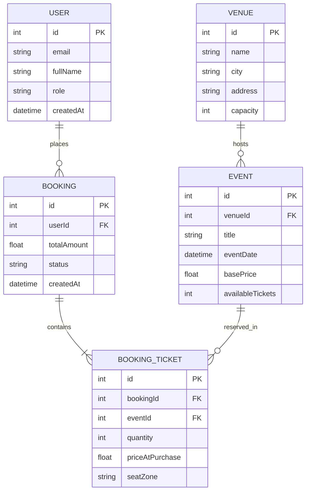

# Вебплатформа бронювання заходів та продажу квитків (EventTicketing)

**Дисципліна:** Технологія розробки Інтернет-застосунків  
**Виконавець:** Кошик Михайло Сергійович, студент групи 2ПРс (спеціальність 121 / F2 «Інженерія програмного забезпечення»)  
**Варіант:** № 11  

---

## 1. Опис предметної області

Проєкт реалізує бекенд-моноліт вебзастосунку **EventTicketing** для онлайн-анонсування культурних, освітніх та розважальних заходів, керування майданчиками проведення подій і бронювання квитків користувачами.

### Основні сутності предметної області (5 сутностей):
1. **USER** — зареєстрований користувач платформи (відвідувач, організатор або адміністратор), який створює замовлення на квитки.
2. **VENUE** — фізичний або віртуальний майданчик (концертний зал, конференц-центр, лекторій), де проводяться заходи.
3. **EVENT** — конкретний захід із датою проведення, базовою ціною квитка та кількістю доступних місць, прив'язаний до певного майданчика (VENUE).
4. **BOOKING** — замовлення користувача (USER), яке фіксує загальну вартість, статус оплати та дату оформлення бронювання.
5. **BOOKING_TICKET** — проміжна сутність для реалізації зв'язку багато-до-багатьох (N:M) між замовленнями (BOOKING) та заходами (EVENT). Містить власні атрибути позиції замовлення: кількість квитків (quantity), зафіксовану ціну на момент покупки (priceAtPurchase) та категорію місця (seatZone).

---

## 2. ER-діаграма сутностей (Mermaid ERD)

